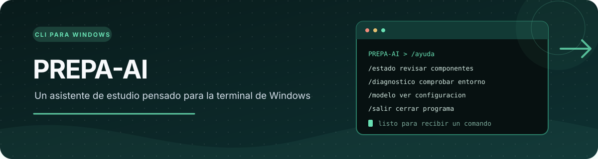
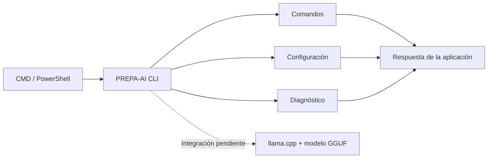

<p align="center">
  
</p>

<p align="center">
  
  
  
  
</p>

<h1 align="center">PREPA-AI</h1>
<p align="center">Un asistente de estudio pensado para ejecutarse desde CMD o PowerShell.</p>

<p align="center">
  <a href="#cómo-está-organizado">Organización</a> ·
  <a href="#comandos">Comandos</a> ·
  <a href="#preparar-el-proyecto">Preparación</a> ·
  <a href="#estado-actual">Estado actual</a>
</p>

PREPA-AI es un asistente para usar desde la terminal de Windows. Quiero que pueda servir como apoyo para estudiar y trabajar en proyectos de la escuela, incluso cuando no haya internet.

Estoy empezando por una CLI para PowerShell y CMD. La intención es que se pueda llevar en una memoria USB y ejecutar en distintas computadoras.

## Cómo está organizado



> La conexión con llama.cpp y la respuesta real de un modelo todavía no están integradas ni comprobadas.

## Estado actual

La estructura de la CLI, los comandos básicos, las pruebas y la compilación del ejecutable están preparados. El motor de IA local sigue pendiente; por eso no lo considero una IA local terminada.

## Comandos

| Comando | Qué hace |
|---|---|
| `/ayuda` | Muestra los comandos |
| `/estado` | Consulta el estado |
| `/limpiar` | Limpia la conversación actual |
| `/modelo` | Muestra la configuración del modelo |
| `/diagnostico` | Revisa componentes |
| `/version` | Muestra la versión |
| `/salir` | Cierra el programa |

## Preparar el proyecto

Se necesita Python 3.10 o superior para construirlo desde el código:

```powershell
.\scripts\build.ps1
```

El paquete se prepara en `dist/package/`.

Para usar un modelo local todavía hay que preparar llama.cpp y colocar un modelo GGUF compatible en la carpeta indicada. Los pasos están en [docs/ASSETS.md](docs/ASSETS.md).

## Documentación

| Guía | Qué contiene |
|---|---|
| [Comandos](docs/CLI.md) | Uso de la terminal |
| [Archivos del motor y modelo](docs/ASSETS.md) | Preparación de llama.cpp y GGUF |
| [Uso desde USB](docs/USB.md) | Llevar el programa a otra computadora |
| [Privacidad](docs/PRIVACY.md) | Qué datos se guardan |
| [Problemas comunes](docs/TROUBLESHOOTING.md) | Errores y revisiones |

## Qué quiero conseguir

- Que funcione sin conexión después de preparar el motor y el modelo.
- Que los archivos necesarios puedan ir junto al programa.
- Que el historial no se guarde automáticamente en disco.
- Que los comandos sean fáciles de usar desde la terminal.

<p align="center"><sub>Proyecto en desarrollo · El rendimiento dependerá del modelo, el equipo y la memoria disponible.</sub></p>
